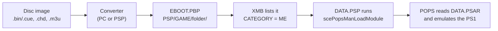
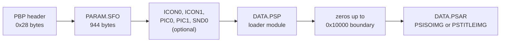
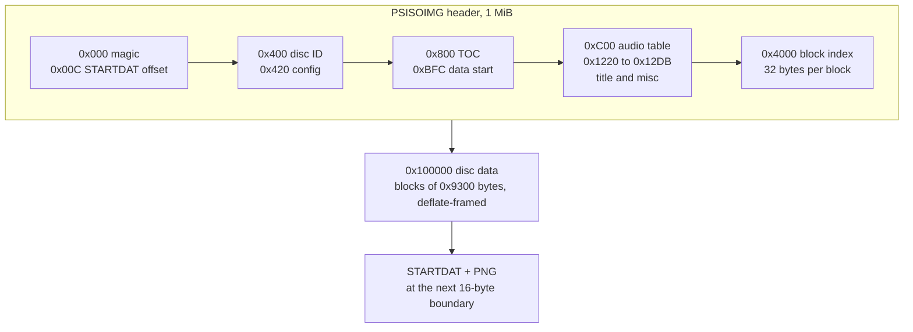
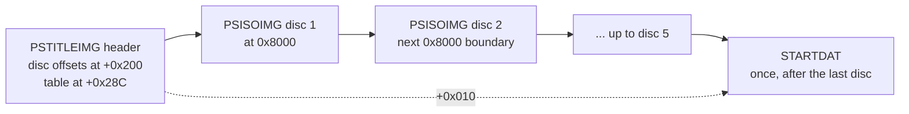
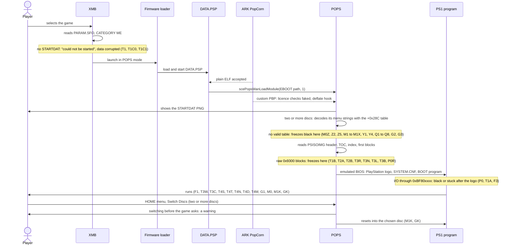
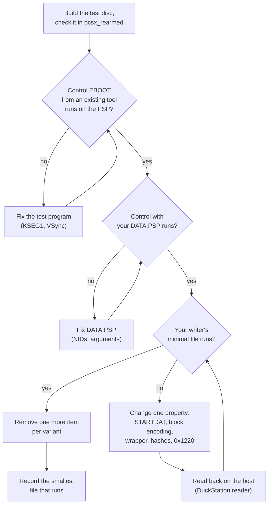
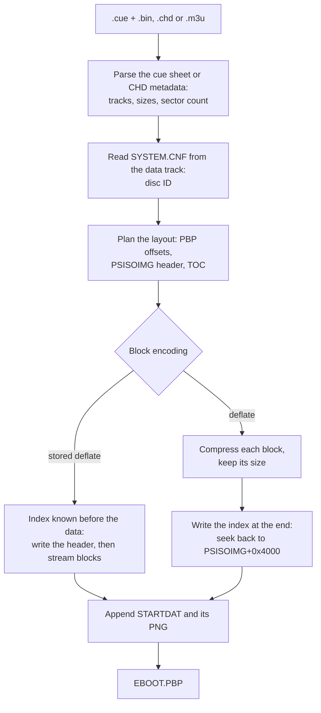
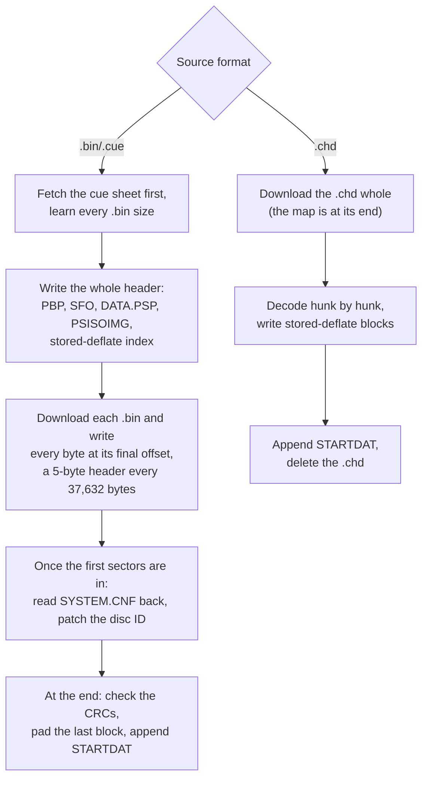

# PS1 games on PSP: a POPS and EBOOT reference

A PSP plays PlayStation (PS1) games through POPS, the PS1 emulator built into its firmware. POPS
does not read disc images: it reads one file, an `EBOOT.PBP` in a special layout. This page
explains that layout from zero, shows what we tested on a real PSP, and ends with what a tool
needs in order to build such files from `.bin/.cue` or `.chd` images **without any Sony-made
data**, and the one place where that is not possible: a multi-disc file with in-game disc
switching.

It is written for developers of ROM converters and similar tools, as much as for Skiff itself.
Nothing here needs Skiff. Skiff's own PS1 installer is still being designed
([roadmap, Phase 5](roadmap.md#phase-5-ps1)); the prototype writer and test scripts behind the
results below are not in the repository yet, so this page describes what they do rather than
linking to them.

Every statement is one of four kinds, and the page says which when it matters:

- **Measured**: we built the file and ran it on a PSP (2026-10-13), or measured it on the PSP;
- **Documented**: a public source says so (linked, with its date, in [Sources](#sources));
- **Analysed**: read from the code of the official 6.61 firmware's POPS modules (see
  [How POPS uses it](#how-pops-uses-it)); no firmware file or data taken from it is kept or
  published;
- **Inferred**: it follows from the above but nobody has tested it. Treat it as a hypothesis.

## Contents

- [The short version](#the-short-version)
- [Concepts](#concepts)
- [The EBOOT.PBP file](#the-ebootpbp-file)
- [Boot sequence and where it fails](#boot-sequence-and-where-it-fails)
- [What works and what does not](#what-works-and-what-does-not)
- [The multi-disc table](#the-multi-disc-table)
- [Testing methodology](#testing-methodology)
- [Designing a converter](#designing-a-converter)
- [Licensing and clean room](#licensing-and-clean-room)
- [Open questions](#open-questions)
- [Glossary](#glossary)
- [Sources](#sources)

## The short version

On a PSP-1000 running ARK custom firmware with the stock POPS (measured, 2026-10-13), a
single-disc PS1 EBOOT boots when it has:

1. a PBP container with a 944-byte `PARAM.SFO` whose `CATEGORY` is `ME`;
2. a `DATA.PSP` that calls one firmware function, `scePopsManLoadModule`. Ours is 2,194 bytes,
   built with pspsdk; no Sony or GPL module is needed;
3. a `DATA.PSAR` holding a `PSISOIMG0000` header, a table of contents, a block index and the disc
   image cut into 0x9300-byte blocks (16 raw sectors);
4. **every block framed as deflate**: compressed, or wrapped in a 5-byte deflate "stored" header
   that costs no CPU. Blocks stored as plain raw bytes never booted;
5. a `STARTDAT` section after the disc data, holding any PNG. Without it the XMB refuses to start
   the game.

Not needed: Sony's encrypted `PGD` footer, Sony's boot logo, `KEYS.BIN`, the SHA-1 hashes in the
index, a `PSTITLEIMG` wrapper for a single disc, the "magic" value other tools write at 0x1220,
and the opaque template and configuration bytes other tools copy around, with one exception
below. A real commercial disc runs from such a file (G1).

Two discs in one EBOOT (measured with two) need the same per disc, inside a `PSTITLEIMG` wrapper:
each disc's own `PSISOIMG`, one STARTDAT after the last disc, and **a 64-byte table at
PSTITLEIMG+0x28C**. Without the table the game freezes at a black screen; with it, the HOME menu
offers "Switch Discs" and switching works. That table is the exception: it is a key derived from
Sony's firmware, the same for every game, and no tool can compute a working one from facts alone
(see [The multi-disc table](#the-multi-disc-table)). The alternative is one EBOOT per disc, each
carrying disc 1's ID: no table, a shared memory card, but no switching inside the game.

One more finding matters to anyone who builds test programs: PS1 programs built with PSn00bSDK
releases since v0.22 address hardware through `0xBF80xxxx` and go black under POPS. Rebuilt with
`0x1F80xxxx`, the same program runs.

## Concepts

### POPS

POPS is Sony's PS1 emulator, part of the PSP firmware. Sony used it to sell PS1 games ("PS1
Classics") as downloads. Each download is an `EBOOT.PBP` whose disc image is compressed with
Sony's own scheme and encrypted, and whose `DATA.PSP` is a small encrypted Sony module that
starts POPS. On official firmware, POPS only runs such signed, licensed files.

POPS emulates the PS1 hardware and BIOS itself: no PS1 BIOS file is involved. When a game starts
it shows a boot image taken from the EBOOT, then the emulated BIOS's PlayStation logo, then the
game.

### How the XMB starts a PS1 EBOOT

The XMB (the PSP's home menu) lists every `PSP/GAME/<folder>/EBOOT.PBP` on the Memory Stick and
reads its `PARAM.SFO`. `CATEGORY = ME` marks a PS1 game. Launching one starts the firmware in POPS
mode, which loads the EBOOT's `DATA.PSP` as the program to run. That module asks the firmware to
load POPS for this EBOOT, and POPS reads the rest of the file (documented, uOFW `init.c`; see
[Sources](#sources)).



### What custom firmware changes

A file built by a converter has no Sony signature, licence or encryption. Custom firmware makes
POPS accept it anyway. On ARK (ARK-4 and its successor ARK-5), the part that does this is
**PopCorn** (documented, ARK source):

- a PBP is "custom" when the 4 bytes at `DATA.PSAR + 0x400` (single disc) or `+ 0x200`
  (multi-disc) are not `\0PGD`, the marker of Sony's encrypted data;
- for a custom PBP, PopCorn fakes the licence checks (RIF, `act.dat`, the version key, `amctrl`),
  so **no `KEYS.BIN` or licence file is needed**;
- it rewrites a read of `~ELF` into `~PSP`, so a plain, unencrypted ELF `DATA.PSP` loads;
- it routes block decompression to the firmware's `sceKernelDeflateDecompress`, so blocks are
  deflate rather than Sony's own scheme;
- it re-enables CD audio stored as raw tracks, which later firmware had disabled;
- for a multi-disc file, it stubs out the per-disc MAC check popsman makes on the disc map
  (analysed). It does **not** replace the multi-disc table POPS needs (see
  [The multi-disc table](#the-multi-disc-table)).

Adrenaline, the equivalent on PS Vita, patches the same call sites, but behaves differently in
places (see [Open questions](#open-questions)).

This page does not cover installing custom firmware. Follow the firmware's own instructions:
[ARK-4](https://github.com/PSP-Archive/ARK-4) (archived) or
[ARK-5](https://github.com/PSP-Arkfive/ARK-5) ([FasterARK](https://github.com/PSP-Arkfive/FasterARK)
installs it).

### Disc images in five minutes

| Term | Meaning |
|---|---|
| Raw sector | 2,352 bytes: everything a CD stores per sector except subcode. PS1 discs are read in this form |
| Mode 2 Form 1 | The data sector layout PS1 discs use for files: 12 sync bytes, 4 header bytes, 8 subheader bytes, then 2,048 bytes of user data at offset 24 (Form 2, for streamed audio and video, carries 2,324 bytes) |
| Audio (CD-DA) | A raw sector that is 2,352 bytes of 16-bit stereo samples at 44.1 kHz |
| Frame, MSF | One sector is one frame; 75 frames per second. Positions are written minutes:seconds:frames |
| LBA | Sector number from the start of the image. The absolute MSF is LBA + 150 frames (the 2-second pregap before LBA 0) |
| BCD | Each byte holds two decimal digits: 0x14 means 14 |
| Track | A run of sectors, either data or audio. Most PS1 discs have one data track; some add audio tracks |
| Cue sheet (`.cue`) | A text file listing the `.bin` files and where each track starts (`INDEX 01`) |
| CHD | MAME's compressed disc format: the whole disc, including subcode, in compressed "hunks" |
| `.m3u` | A playlist naming the discs of a multi-disc game, in order |
| `SYSTEM.CNF` | A text file on the disc; its `BOOT` line names the program to start, and that name is the disc ID (`SLUS_999.99`) |

## The EBOOT.PBP file

All numbers are little-endian. Offsets are hexadecimal. "PSISOIMG+0x400" means 0x400 bytes after
the start of the `PSISOIMG` header.

### PBP container

A 0x28-byte header, then eight sections back to back in a fixed order. Each section's size is the
next section's offset minus its own; an absent section has size 0.

| Offset | Size | Content |
|---|---|---|
| 0x00 | 4 | magic `00 50 42 50` (`\0PBP`) |
| 0x04 | 4 | version `0x00010000` |
| 0x08 | 4 | offset of `PARAM.SFO` (always 0x28) |
| 0x0C | 4 | offset of `ICON0.PNG` (the XMB icon) |
| 0x10 | 4 | offset of `ICON1.PMF` (animated icon) |
| 0x14 | 4 | offset of `PIC0.PNG` (information overlay) |
| 0x18 | 4 | offset of `PIC1.PNG` (background) |
| 0x1C | 4 | offset of `SND0.AT3` (background sound) |
| 0x20 | 4 | offset of `DATA.PSP` |
| 0x24 | 4 | offset of `DATA.PSAR` |

`DATA.PSAR` starts on a 0x10000 boundary in both the reference tool's output and ours; the gap
before it is zero. Our test files had no icon, pictures or sound (all four sizes 0) and booted.



### PARAM.SFO

The SFO format is a header (`\0PSF`, version `0x00000101`, key table offset, data table offset,
entry count), one 16-byte index entry per key (u16 key offset, u16 format, u32 used length, u32
maximum length, u32 data offset), the key names, then the values. Keys are sorted by name. Format
`0x0204` is a NUL-terminated UTF-8 string, `0x0404` a u32.

A PS1 EBOOT carries nine keys. Each value has a fixed maximum length, so the SFO is always
**944 bytes** and every value sits at a fixed offset; the disc ID and title can be rewritten in
place later.

| Key | Format | Max | Value offset in SFO | Value we used | Notes |
|---|---|---|---|---|---|
| BOOTABLE | u32 | 4 | 0x100 | 1 | |
| CATEGORY | string | 4 | 0x104 | `ME` | marks a PS1 game |
| DISC_ID | string | 16 | 0x108 | `SLUS99999` | no `_`, `-` or `.`; does **not** name the save folder (PSISOIMG 0x400 does, G4) |
| DISC_VERSION | string | 8 | 0x118 | `1.00` | |
| LICENSE | string | 512 | 0x120 | `Skiff` | other tools copy Sony's copyright line; neutral text works (measured) |
| PARENTAL_LEVEL | u32 | 4 | 0x320 | 3 | |
| PSP_SYSTEM_VER | string | 8 | 0x324 | `3.01` | |
| REGION | u32 | 4 | 0x32C | 0x8000 | |
| TITLE | string | 128 | 0x330 (PBP 0x358) | the game's name | shown in the XMB |

The key table starts at SFO+0xA4 and the value table at SFO+0x100. We did not test leaving keys
out.

### DATA.PSP

`DATA.PSP` is the program the firmware runs in POPS mode. Its whole job is one call
(documented, see [Sources](#sources)):

| NID | Name | Arguments | Use |
|---|---|---|---|
| `0x29B3FB24` | `scePopsManLoadModule` | path of this EBOOT (`argv[0]`), mode 1 | loads POPS for this EBOOT |
| `0x0090B2C8` | `scePopsManExitVSHKernel` | error code `0x80000004` | returns to the XMB if loading failed |

Both are in the kernel library `scePopsMan`, for which pspsdk has no import stub; a one-file
assembly stub with `IMPORT_START "scePopsMan"` and two `IMPORT_FUNC` lines provides them.

Sony's encrypted module is not needed, and neither is the 19,002-byte GPLv2 reimplementation that
every popstation-family tool embeds. Skiff's loader is a user-mode PRX built with pspsdk's
`build_prx.mak`, with no C library: **2,194 bytes**. Its main thread does this (our MIT code):

```c
static int loader_thread(SceSize args, void *argp)
{
    const char *pbp_path = args > 0 ? (const char *)argp : "";

    if (scePopsManLoadModule(pbp_path, POPS_LOAD_MODE) < 0) {
        scePopsManExitVSHKernel(POPS_LOAD_FAILED);
    }
    return sceKernelExitDeleteThread(0);
}
```

`module_start` creates that thread (priority 0x20, 16 KiB stack) and starts it with the module's
arguments. The module is the same for every game, so a converter builds it once and embeds the
bytes. Under ARK it loads as a plain ELF (measured: variant T1A and every passing variant use it).

### DATA.PSAR, one disc: PSISOIMG

For one disc, `DATA.PSAR` is a single `PSISOIMG`: a 1 MiB header region, then the disc data.



#### Header fields

| Offset | Size | Content | What we know |
|---|---|---|---|
| 0x000 | 12 | `PSISOIMG0000` | |
| 0x00C | 4 | offset of `STARTDAT` = end of the last stored block, rounded up to 16 | measured in the reference file; ours the same |
| 0x400 | 32 | disc ID as `_SLUS_99999` | ARK reads it here; POPS names the save folder after it (G4, G5) |
| 0x420 | up to 0x3E0 | per-game POPS configuration | the reference tool writes 217 non-zero default bytes; all zero works (measured) |
| 0x800 | up to 0x3FC | table of contents, 10 bytes per entry | see [TOC](#table-of-contents) |
| 0xBFC | 4 | `0x00100000`, where the disc data starts | always this value |
| 0xC00 | 0x620 | ATRAC3 audio track table (Sony's compressed CD audio) | zero for raw audio |
| 0x1220 | 4 | offset of "special data" after STARTDAT | the reference writes `[0x00C] + 0x2D31`; we booted with that and with the end of STARTDAT (T4M) |
| 0x1228 | 2 | `0x07FF` | meaning unknown; every tool writes it, so did we |
| 0x122C | 128 | title | |
| 0x12B0 | 4 | libcrypt magic word | zero (ARK computes it) |
| 0x12D4 | 8 | subchannel data offset and count | zero |
| 0x4000 | 32 × n | block index, n = ceil(image size / 0x9300), at most 32,256 entries | see [Block index](#block-index) |
| 0x100000 | | disc data | |

Everything not listed is zero in our files. The 0x2D31 in the reference is the size of a 0x50-byte
STARTDAT header plus the 11,489-byte logo of the original popstation template; the reference keeps
it whatever its own PNG's size (10,344 bytes in our reference file), and POPS does not seem to
check it.

#### Table of contents

CloneCD-style lead-in entries, 10 bytes each, positions in BCD MSF:

| Byte | Content |
|---|---|
| 0 | control (high nibble: 4 data, 0 audio) and ADR (low nibble: 1) |
| 1 | TNO, 0 |
| 2 | POINT: `A0`, `A1`, `A2` or a track number (BCD) |
| 3–5 | AMIN, ASEC, AFRAME |
| 6 | zero |
| 7–9 | PMIN, PSEC, PFRAME |

The entries, in this order:

| POINT | P field | Example: one data track of 1,054 sectors |
|---|---|---|
| `A0` | first track number, disc type (`0x20` = CD-ROM XA, as PS1 discs are), 0 | `41 00 A0 00 00 00 00 01 20 00` |
| `A1` | last track number, 0, 0 | `41 00 A1 00 00 00 00 01 00 00` |
| `A2` | lead-out position (see below) | `41 00 A2 00 00 00 00 00 14 05` |
| `01`… | each track's start: its `INDEX 01` LBA + 150 frames | `41 00 01 00 00 00 00 00 02 00` |

Two details differ between the reference file and ours, and both boot:

- the reference sets control 0 (`01`) on `A1` and `A2`, we set the last track's (`41`);
- the reference fills track 1's A field with `00:02:01`, one frame past P; we leave it zero.

**The lead-out is an open question.** By the CD standard (ECMA-130) the lead-out's absolute
position is sectors + 150 frames. The reference file instead writes sectors + 1 with no
150-frame offset: `00:14:05` (1,055 frames) for 1,054 sectors. Every variant that booted used the
reference's convention; our test program never reads near the end of its disc, so it cannot tell
the two apart. It matters: ARK patches the lead-out of one tool's hard-coded TOC, which suggests
POPS bounds disc reads by it. See [Open questions](#open-questions).

#### Block index

One 32-byte entry per 0x9300-byte block:

| Offset | Size | Content |
|---|---|---|
| +0 | u32 | offset of the stored block, relative to PSISOIMG+0x100000 |
| +4 | u16 | stored size of the block |
| +6 | u16 | marker: 0 |
| +8 | 16 | first 16 bytes of the SHA-1 of the uncompressed 0x9300 block (the last block zero-padded), or zeros |
| +24 | 8 | zero |

- Blocks are packed back to back: each offset is the previous offset plus the previous size.
- The marker must be 0: with 1, raw CD audio buzzes (documented, tested by pop-fe's maintainer).
- The SHA-1 is optional: zero hashes booted with stored blocks (T4N) and with deflate blocks
  (T4D). The reference tool computes it.
- 32,256 entries fit between 0x4000 and 0x100000, so one disc can hold up to 1,213,857,792 bytes
  (1.13 GiB) of image, more than any CD.

#### Block encodings

The disc image is cut into blocks of 0x9300 bytes (37,632 bytes = 16 raw sectors); the last block
is padded with zeros. Each block is stored in one of three ways:

| Encoding | Stored size | Stored bytes | Boots (measured) |
|---|---|---|---|
| Raw | 0x9300 | the 16 sectors as they are | **never**: 8 variants, with and without hashes, wrapped or not |
| Deflate | less than 0x9300 | raw deflate (RFC 1951; no zlib header or checksum) inflating to exactly 0x9300 bytes; the reference uses level 1 | yes |
| Stored deflate | 0x9305 | the 5-byte deflate stored-block header `01 00 93 FF 6C`, then the 16 sectors unchanged | yes |

The stored-deflate header is a final (`BFINAL = 1`), uncompressed (`BTYPE = 00`) deflate block:
byte `0x01`, then `LEN = 0x9300` and `NLEN = 0x6CFF`, little-endian. Any inflater turns it back
into the 0x9300 bytes, and writing it costs no compression CPU.

Why raw blocks fail is inferred, not proven: on custom PBPs, ARK sends every block through
`sceKernelDeflateDecompress`, and raw sectors are not a deflate stream. Sony's own files do contain
raw 0x9300 blocks, but those are read through Sony's code path.

A converter that uses deflate must still handle a block that does not shrink (rare on PS1 discs,
but possible): store that block as stored deflate (0x9305), never raw. A file mixing deflate and
stored-deflate blocks follows from both being tested, but has not itself been tested.

### STARTDAT

STARTDAT follows the disc data, at the offset in PSISOIMG+0x00C. POPS shows its PNG while it
starts.

| Offset | Size | Content |
|---|---|---|
| 0x00 | 8 | `STARTDAT` |
| 0x08 | 4 | 1 |
| 0x0C | 4 | 1 |
| 0x10 | 4 | header size, 0x50 |
| 0x14 | 4 | PNG size |
| 0x18 | 0x38 | zeros |
| 0x50 | | the PNG |

Every popstation-family tool appends a 4,976-byte block starting with `\0PGD` after the PNG:
encrypted data copied from a Sony EBOOT. **Leave it out.** The reference file without it reached
the same point as with it (P0N), and our own files, which never had it, boot.

STARTDAT itself is **required**: without it, the XMB refuses to start the game ("The game could
not be started", data corrupted; T1, T1C0, T1C1). Our PNG was a generated 480×272 8-bit greyscale
image of 486 bytes; POPS showed it.

### Multi-disc: PSTITLEIMG

A game of 2 to 5 discs puts a `PSTITLEIMG` header at the start of `DATA.PSAR`, followed by one
complete PSISOIMG per disc, each aligned to 0x8000. Offsets below are relative to `DATA.PSAR`:

| Offset | Size | Content | What we know |
|---|---|---|---|
| 0x000 | 16 | `PSTITLEIMG000000` | |
| 0x010 | 4 | offset of STARTDAT, after the last disc | measured (M1K) |
| 0x200 | 5 × 4 | offsets of each disc's PSISOIMG, zero after the last | POPS takes the number of discs from it (analysed) |
| 0x214 | 0x30 | opaque bytes in the reference file | zero works (Z1, Z4, M1K) |
| 0x264 | 32 | disc ID of disc 1, `_SLUS_99999` | |
| 0x284 | 4 | the 0x1220 counterpart: STARTDAT offset + 0x2D31 in the reference | the end of STARTDAT works (M1K) |
| 0x28C | 0x80 | **the multi-disc table**: bytes 0x00–0x3F are read, 0x40–0x7F never | **required** for two discs; see [The multi-disc table](#the-multi-disc-table) |
| 0x30C | 128 | title | |
| 0x38C | 4 | a small non-zero value in the reference file | zero works (Z3, Z4, M1K) |

Layout rules, measured with two discs (M1K, our own file, and GK, a real game):

- disc 1's PSISOIMG starts at 0x8000, each later one at the next 0x8000 boundary;
- each PSISOIMG is complete, laid out as a single disc's: its own ID at 0x400, its own TOC and
  index, and its own 0x00C pointing at **the end of its own data** (relative to its own
  PSISOIMG), not at a STARTDAT of its own;
- one STARTDAT, after the last disc, at the offset in PSTITLEIMG+0x010;
- `PARAM.SFO` `DISC_ID` and PSTITLEIMG+0x264 carry disc 1's ID;
- only the first 64 bytes of the table are needed; the other 64 were zero in M1K.

G3 tried the other placement (every disc's 0x00C pointing at the one STARTDAT), but without the
table, so that placement is not ruled out; it is simply not needed. Every other byte the
reference tool writes into PSTITLEIMG was zero in M1K, which also kept our own TOC details, 0x1220
value and stored-deflate blocks; switching those to the reference's had not fixed the freeze
(M1T, M1L, M1D, M1X).



A one-disc PSTITLEIMG (the PSISOIMG at 0x8000) boots like a bare PSISOIMG and needs no table
(T3W, T4S: zeroed). pop-fe's maintainer found that old POPS versions (such as 3.02) do not
support PSTITLEIMG at all, so a single disc should use a bare PSISOIMG. Three to five discs follow
from the same rules but were not tested.

### A worked example

Variant T4T: our test disc (2,479,008 bytes = 1,054 sectors = 66 blocks), stored deflate, bare
PSISOIMG, no icons. Absolute file offsets:

| File offset | Content |
|---|---|
| 0x000000 | PBP header: SFO at 0x28, ICON0 to DATA.PSP all at 0x3D8, DATA.PSAR at 0x10000 |
| 0x000028 | PARAM.SFO, 944 bytes |
| 0x0003D8 | DATA.PSP, 2,194 bytes, then zeros |
| 0x010000 | `PSISOIMG0000`; +0x00C = 0x35E750 |
| 0x010400 | `_SLUS_99999` |
| 0x010800 | TOC, 4 entries |
| 0x010BFC | 0x00100000 |
| 0x011220 | 0x00361481 (0x35E750 + 0x2D31) |
| 0x011228 | 0x07FF, then the title at 0x01122C |
| 0x014000 | index: entry k = offset k × 0x9305, size 0x9305, marker 0 |
| 0x110000 | 66 blocks × 0x9305 = 2,484,042 bytes |
| 0x36E750 | STARTDAT header, then the 486-byte PNG; end of file at 3,598,726 bytes |

Every offset in this table follows from the image size alone.

## Boot sequence and where it fails

What happens between pressing ✕ on the icon and the game's first frame, with the failures we saw
marked where they happen:



The roles of the firmware loader and PopCorn are documented; the order of the reads inside POPS
is inferred from what the screen showed, except the multi-disc step, which is analysed: POPS
decodes its multi-disc menu strings while it starts, and a wrong table makes it write through a
NULL pointer ([How POPS uses it](#how-pops-uses-it)). We did not find out which component refuses
a file without STARTDAT, only that the refusal comes before any image is shown. P0R (the
reference file with every block re-stored raw) showed a black screen without any logo.

## What works and what does not

### Test setup

| | |
|---|---|
| Console | PSP-1000 |
| Firmware | official 6.61 with ARK custom firmware (ARK-5), stock POPS, no popsloader |
| Date | 2026-10-13, eleven rounds of variants, each round one Memory Stick session |
| Pass | the test program's screen appears and keeps running; for two discs we also noted whether the HOME menu offered the disc switch |
| Reference tool | pop-fe at commit `45dff05`, run in Docker without network; its output (P0, M0) contains GPL and Sony-made data and was used only as a control, never shipped |
| Our writer | a clean-room prototype written from the documented facts on this page |
| Disc ID | synthetic: `SLUS_999.99`, and `SLUS_999.98` for the first of the two-disc set |
| Language | English; Spanish for one run in round 10 |

The test discs (see [Testing methodology](#testing-methodology)):

| Disc | Program | I/O addresses |
|---|---|---|
| Fixture | PSn00bSDK v0.24 `template` (text and a moving square), 1,024 padding sectors | `0xBF80xxxx` (KSEG1) |
| F1 | the same template, libpsn00b rebuilt with `IOBASE 0x1f800000` and `EXP1BASE 0x1f000000`, one frame drawn before the first `VSync()` | `0x1F80xxxx` |
| F2 | bare-metal program filling the screen through the GPU registers at `0x1F801810` | `0x1F80xxxx` |
| F3 | the same at `0xBF801810` | `0xBF80xxxx` |
| F1D1, F1D2 | F1 built twice as a two-disc set: IDs `SLUS_999.98` and `SLUS_999.99`, showing "DISC 1" and "DISC 2" on screen | `0x1F80xxxx` |

From round 5 on, some rows (G) use a commercial two-disc game the maintainer owns, converted
locally and never distributed. It is named nowhere here on purpose.

### Results

| ID | Round | Disc | Built by | Blocks | STARTDAT | Wrapper | Index SHA-1 | 0x1220 | Result | Conclusion |
|---|---|---|---|---|---|---|---|---|---|---|
| P0 | 1 | Fixture | pop-fe | deflate L1 | Sony footer, tool's logo | PSTITLEIMG | yes | reference | PlayStation logo, then black | the path to the BIOS works; black is the program |
| T1A | 1 | Fixture | P0 with our DATA.PSP | deflate L1 | as P0 | PSTITLEIMG | yes | reference | same as P0 | **our 2,194-byte DATA.PSP loads POPS** |
| T1 | 1 | Fixture | ours | raw | none | none | zero | ours | XMB: game could not be started | |
| T1C1 | 1 | Fixture | ours | deflate L1 | none | none | zero | ours | same | |
| T1C0 | 1 | Fixture | ours | stored deflate | none | none | zero | ours | same | **STARTDAT is required** |
| T1B | 1 | Fixture | ours | raw | ours | none | zero | ours | our STARTDAT image, then frozen | STARTDAT accepted; raw blocks suspect |
| P0R | 2 | Fixture | P0, every block re-stored raw | raw | as P0 | PSTITLEIMG | yes | reference | frozen, black, no logo | **raw blocks fail even in the reference layout** |
| P0N | 2 | Fixture | P0 without the PGD footer | deflate L1 | tool's logo, no footer | PSTITLEIMG | yes | reference | PlayStation logo | **the Sony PGD footer is not needed** |
| T2A | 2 | Fixture | ours | raw | ours | none | yes | ours | our STARTDAT image, then frozen | raw fails |
| T2B | 2 | Fixture | ours | raw | ours | none | yes | reference | our STARTDAT image, then frozen | raw fails |
| T2C | 2 | Fixture | ours | deflate L1 | ours | none | yes | reference | our image, PlayStation logo, then black | **our own file reaches the BIOS**; black is the program |
| T2W | 2 | Fixture | ours | deflate L1 | ours | PSTITLEIMG, zeroed template bytes | yes | reference | same as T2C | the wrapper works without template bytes |
| T2R | 2 | Fixture | ours | raw | ours | PSTITLEIMG | yes | reference | reported as T2C | contradicts every other raw variant; not reproduced by T3R on F1 |
| F1 | 2 | F1 | pop-fe | deflate L1 | as P0 | PSTITLEIMG | yes | reference | **runs** | **the black screen was the program's I/O addresses** |
| F2 | 2 | F2 | pop-fe | deflate L1 | as P0 | PSTITLEIMG | yes | reference | black | inconclusive (likely our display setup) |
| F3 | 2 | F3 | pop-fe | deflate L1 | as P0 | PSTITLEIMG | yes | reference | stuck on the PlayStation logo | consistent with KSEG1 I/O failing |
| T3R | 3 | F1 | ours | raw | ours | PSTITLEIMG | yes | reference | does not boot | |
| T3N | 3 | F1 | ours | raw | ours | PSTITLEIMG | zero | reference | does not boot | |
| T3L | 3 | F1 | ours | raw | ours | PSTITLEIMG | yes | ours | does not boot | |
| T3B | 3 | F1 | ours | raw | ours | none | yes | reference | does not boot | **raw blocks never boot** |
| T3W | 3 | F1 | ours | deflate L1 | ours | PSTITLEIMG, zeroed template bytes | yes | reference | **runs** | **no Sony-made byte is needed** |
| T3C | 3 | F1 | ours | deflate L1 | ours | none | yes | reference | **runs** | **a bare PSISOIMG is enough** |
| T4S | 4 | F1 | ours | stored deflate | ours | PSTITLEIMG | yes | reference | **runs** | |
| T4T | 4 | F1 | ours | stored deflate | ours | none | yes | reference | **runs** | **stored deflate works: no compression CPU** |
| T4N | 4 | F1 | ours | stored deflate | ours | none | zero | reference | **runs** | **SHA-1 not needed** |
| T4D | 4 | F1 | ours | deflate L1 | ours | none | zero | reference | **runs** | SHA-1 not needed with deflate either |
| T4M | 4 | F1 | ours | deflate L1 | ours | none | yes | end of STARTDAT | **runs** | **the 0x1220 value is free** |
| G1 | 5 | the game's disc 1 | ours | stored deflate | ours | none | zero | end of STARTDAT | **the game plays** | **the minimal recipe runs a real game**, all three choices in one file |
| G2 | 5 | the game, discs 1 and 2 | ours | stored deflate | ours | PSTITLEIMG, 2 discs, zeroed template bytes | zero | end of STARTDAT | black, frozen, no PlayStation logo | no table (found in round 7) |
| G3 | 5 | as G2 | ours | stored deflate | ours | as G2, every disc's 0x00C pointing at the one STARTDAT | zero | as G2 | as G2 | not the 0x00C placement alone |
| M0 | 6 | F1D1 + F1D2 | pop-fe | deflate L1 | as P0 | PSTITLEIMG, 2 discs | yes | reference | **runs**; the HOME menu offers a disc switch | two-disc control |
| M0D | 6 | F1D1 + F1D2 | M0 with our DATA.PSP | deflate L1 | as P0 | as M0 | yes | reference | runs | our DATA.PSP works for two discs |
| M0S | 6 | F1D1 + F1D2 | M0 without the PGD footer | deflate L1 | tool's logo, no footer | as M0 | yes | reference | runs | no footer needed for two discs either |
| M0Z | 6 | F1D1 + F1D2 | M0 with PSTITLEIMG +0x214–0x243, +0x28C–0x30B and +0x38C zeroed | deflate L1 | as P0 | as M0, template bytes zeroed | yes | reference | boot image, then frozen, black | **two discs need some of the template bytes** (one disc does not: T3W) |
| M1 | 6 | F1D1 + F1D2 | ours | stored deflate | ours, after disc 2 | PSTITLEIMG, 2 discs, no template bytes | zero | ours | as M0Z | |
| M1T | 6 | F1D1 + F1D2 | M1 with the reference's TOC control bytes and track 1 A-time | stored deflate | ours | as M1 | zero | ours | as M0Z | not the TOC details |
| M1L | 6 | F1D1 + F1D2 | M1 with the reference's 0x1220 and +0x284 | stored deflate | ours | as M1 | zero | reference | as M0Z | not 0x1220 |
| M1D | 6 | F1D1 + F1D2 | M1 with deflate blocks and SHA-1 | deflate L1 | ours | as M1 | yes | ours | as M0Z | not the encoding or the hashes |
| M1X | 6 | F1D1 + F1D2 | M1 with all three changes | deflate L1 | ours | as M1 | yes | reference | as M0Z | **the difference is in the template bytes** |
| G0 | 6 | the game, discs 1 and 2 | pop-fe | deflate L1 | as P0 | PSTITLEIMG, 2 discs | yes | reference | the game boots; disc switch offered | the game itself works with two discs |
| Z1 | 7 | F1D1 + F1D2 | M0 with +0x214–0x243 zeroed | deflate L1 | as P0 | as M0 | yes | reference | **runs**, switch offered | +0x214 not needed |
| Z2 | 7 | F1D1 + F1D2 | M0 with +0x28C–0x30B zeroed | deflate L1 | as P0 | as M0 | yes | reference | as M0Z | **the +0x28C table is required** |
| Z3 | 7 | F1D1 + F1D2 | M0 with +0x38C zeroed | deflate L1 | as P0 | as M0 | yes | reference | **runs**, switch offered | +0x38C not needed |
| Z4 | 7 | F1D1 + F1D2 | M0 with +0x214–0x243 and +0x38C zeroed | deflate L1 | as P0 | as M0 | yes | reference | **runs**, switch offered | neither, together |
| Z5 | 7 | F1D1 + F1D2 | M0 with +0x28C–0x30B and +0x38C zeroed | deflate L1 | as P0 | as M0 | yes | reference | as M0Z | confirms Z2 |
| S1 | 7 | F1D1 alone | ours | stored deflate | ours | none | zero | ours | **runs** | one EBOOT per disc works |
| S2 | 7 | F1D2 alone, SFO `DISC_ID` of disc 1 | ours | stored deflate | ours | none | zero | ours | **runs** | |
| S3 | 7 | F1D2 alone | ours | stored deflate | ours | none | zero | ours | **runs** | |
| G4 | 7 | the game's disc 2 alone, SFO `DISC_ID` of disc 1 | ours | stored deflate | ours | none | zero | ours | the game plays; POPS created disc 2's save folder; the game reported disc 1's data missing | **the save folder follows PSISOIMG 0x400, not the SFO** |
| Y1 | 8 | F1D1 + F1D2 | M0 with the table replaced by our own pseudo-random bytes | deflate L1 | as P0 | as M0 | yes | reference | as M0Z | a table cannot be invented |
| Y4 | 8 | F1D1 + F1D2 | M0 with the table all `0xFF` | deflate L1 | as P0 | as M0 | yes | reference | as M0Z | |
| Y2 | 8 | F1D1 + F1D2 | M0 with one bit flipped in table byte 0 | deflate L1 | as P0 | as M0 | yes | reference | runs; the switch works but its label is empty | the table feeds the menu text |
| Y5 | 8 | F1D1 + F1D2 | M0 with table bytes 16–127 zeroed | deflate L1 | as P0 | as M0 | yes | reference | as Y2 | |
| Y3 | 8 | F1D1 + F1D2 | M0 with one bit flipped in table byte 127 | deflate L1 | as P0 | as M0 | yes | reference | **runs**, label normal | the end of the table is not read |
| Q1–Q8 | 9 | F1D1 + F1D2 | M0 with eight different pseudo-random tables | deflate L1 | as P0 | as M0 | yes | reference | all as M0Z | no random table works |
| B0, R0 | 9 | F1D1 + F1D2 | M0 with table block 0 (bytes 0–15) zeroed (B) or randomised (R) | deflate L1 | as P0 | as M0 | yes | reference | as M0Z | block 0 is critical |
| B2, R2 | 9 | F1D1 + F1D2 | the same for block 2 (bytes 32–47) | deflate L1 | as P0 | as M0 | yes | reference | runs; label `Swit____`: first four characters right, the rest wrong | |
| B3, R3 | 9 | F1D1 + F1D2 | the same for block 3 (bytes 48–63) | deflate L1 | as P0 | as M0 | yes | reference | runs; label `____ch Discs`: first four characters wrong | |
| B1, R1, B4–B7, R4–R7 | 9 | F1D1 + F1D2 | the same for blocks 1 and 4–7 | deflate L1 | as P0 | as M0 | yes | reference | runs; no visible effect | block 1: see [Open questions](#open-questions) |
| S4 | 9 | F1D2 alone, disc 1's ID in PSISOIMG and SFO | ours | stored deflate | ours | none | zero | ours | **runs**; no new save folder | shares disc 1's folder |
| G5 | 9 | the game's disc 2 alone, disc 1's ID in PSISOIMG and SFO | ours | stored deflate | ours | none | zero | ours | **the game plays and finds disc 1's save data** | **per-disc EBOOTs can share one memory card** |
| M0 (es) | 10 | F1D1 + F1D2 | M0, PSP system language Spanish | deflate L1 | as P0 | as M0 | yes | reference | the HOME menu reads "Cambiar el Disco" | the label is POPS's own text, in the system language |
| M1K | 11 | F1D1 + F1D2 | M1 plus the 64-byte table at +0x28C, the rest of the 0x80 bytes zero | stored deflate | ours, after disc 2 | PSTITLEIMG, 2 discs, table only | zero | ours | **runs**; "Switch Discs" works | **the table is the only missing piece** |
| GK | 11 | the game, discs 1 and 2 | as M1K | stored deflate | ours, after disc 2 | as M1K | zero | ours | **the game plays; switching works** | the same on a real game |

"Reference" in the 0x1220 column means `[0x00C] + 0x2D31` (and the same at PSTITLEIMG+0x284);
"ours" means the end of STARTDAT (the end of the data when there is none). All variants from round 2 on use the
reference's TOC lead-out (sectors + 1); round 1's own variants used sectors + 150. On the KSEG1
fixture "reaches the PlayStation logo" was the best possible result, so round 3 repeats the round 2
variants on F1, where a pass means the program runs. "The table" is the 128 bytes at
PSTITLEIMG+0x28C; its blocks are 16 bytes each, numbered from 0. "Switch offered" means the
HOME menu showed the disc-switch entry. In M1K and GK, switching from the
HOME menu before the program or game asked for a disc showed POPS's warning, then reset the
emulated console into the chosen disc.

### The smallest EBOOT known to boot

This is G1, which ran a real game; T4D shows the same with deflate blocks:

1. PBP header and a 944-byte PARAM.SFO with the nine keys above, `CATEGORY = ME`, neutral
   `LICENSE` text;
2. no ICON0, ICON1, PIC0, PIC1 or SND0;
3. a pspsdk-built `DATA.PSP` calling `scePopsManLoadModule(argv[0], 1)`;
4. `DATA.PSAR` at 0x10000: a bare PSISOIMG with the magic, 0x00C, disc ID, TOC, 0xBFC, 0x1220,
   `0x07FF` at 0x1228, title; configuration, audio table, libcrypt and subchannel fields zero;
5. an index with marker 0 and zero hashes;
6. deflate or stored-deflate blocks from 0x100000;
7. STARTDAT with our own PNG and nothing after it.

Fields we always wrote and never tried without: the `0x07FF` constant, `0xBFC`, the title slots,
the TOC, and each SFO key.

For two discs in one file, M1K (F1D1 + F1D2) and GK (a real game) show the minimum:

1. the PBP header, PARAM.SFO (disc 1's ID) and `DATA.PSP` as above;
2. `DATA.PSAR` at 0x10000: a PSTITLEIMG with the magic, +0x010, the disc offsets at +0x200,
   disc 1's ID at +0x264, +0x284, **the 64-byte table at +0x28C** and the title at +0x30C;
   everything else zero, including the table's last 64 bytes;
3. one PSISOIMG per disc from 0x8000, each at a 0x8000 boundary and built like the single-disc
   file above, with its own ID and its 0x00C at the end of its own data;
4. one STARTDAT with our own PNG after the last disc.

Without the table, the same file freezes (M1). Without in-game switching, one single-disc EBOOT
per disc needs no table (S1 to S4, G4, G5).

### Not required

| Item | Evidence |
|---|---|
| Sony's encrypted `PGD` footer after the STARTDAT PNG | P0N, M0S; all our variants |
| Sony's or the reference tool's boot logo | T3W, T3C, T4*, M1K use our generated PNG |
| `KEYS.BIN`, RIF, `act.dat` | none present in any test; ARK fakes them for custom PBPs |
| Sony's `DATA.PSP` or the GPL "complex" one | T1A, M0D and all our variants use ours |
| Index SHA-1 hashes | T4N, T4D, M1K |
| A PSTITLEIMG for one disc | T3C, T4T, T4N, T4D, T4M |
| The 0x1220 value `[0x00C] + 0x2D31`, and the same at PSTITLEIMG+0x284 | T4M; M1K |
| The reference tool's PSTITLEIMG template bytes, one disc | T3W, T4S (zeroed) |
| The same for two discs, **except the first 64 bytes at +0x28C** | Z1, Z3, Z4, M1K (zeroed) |
| The last 64 bytes of the +0x28C table | M1K (zeroed), Y3; never read (analysed) |
| A STARTDAT per disc | M1K, GK: one after the last disc |
| The reference tool's configuration bytes at 0x420 | all our variants (zero) |
| ICON0, ICON1, PIC0, PIC1, SND0 | all our variants (absent) |
| Sony's copyright line in `LICENSE` | all our variants (`Skiff`) |
| A licence sector on the disc image | the fixtures have none (mkpsxiso writes none); F1 runs |

### What POPS writes back

The first launch of a disc ID creates `PSP/SAVEDATA/<ID>/` (here `SLUS99999`) with
`CONFIG.BIN`, `ICON0.PNG`, `PARAM.SFO`, `SCEVMC0.VMP` and `SCEVMC1.VMP` (measured). The two VMP
files are the PS1 memory cards in slots 1 and 2: a 0x80-byte header (`\0PMV`, a salt seed at 0x0C
and a SHA-1 HMAC at 0x20) followed by the 128 KiB card (documented).

**The folder is named after the ID at PSISOIMG+0x400, not the SFO's `DISC_ID`** (measured). G4,
disc 2 of a real game with disc 1's ID in the SFO only, still created disc 2's folder, and the
game then reported that disc 1's save data was missing. The disc ID written at conversion time
therefore fixes where the game's saves live.

This is what makes one EBOOT per disc usable: write disc 1's ID at PSISOIMG+0x400 **and** in the
SFO of every disc's EBOOT, and all of them share one folder, so one memory card. S4 created no new
folder, and G5, the real game's disc 2 built this way, found the save data written on disc 1. The
disc itself is unchanged: its `SYSTEM.CNF` still names disc 2. Which folders a two-disc file
creates, before and after a switch, was not checked.

## The multi-disc table

A file with two discs needs the 128 bytes at PSTITLEIMG+0x28C, or more exactly their first 64.
Every two-disc file we built without them froze at a black screen after the boot image; adding
only those 64 bytes to our otherwise clean-room file made it run, with working disc switching
(M1K, and GK on a real game). This section explains what the bytes are, why no tool can generate
them, and what a converter can do instead. It does not reproduce them.

### What the hardware showed

- **Without the table, nothing else helps**: the reference file with the table zeroed froze (Z2,
  Z5, M0Z), and so did our own file whatever else we copied from the reference (M1, M1T, M1L,
  M1D, M1X).
- **The bytes matter, not just their presence**: ten invented tables froze (Y1, our own
  pseudo-random bytes; Y4, all `0xFF`; Q1–Q8, eight more random tables).
- **Damage shows up in the menu text**: one bit flipped in byte 0 (Y2), or bytes 16–127 zeroed
  (Y5), left the game running with an empty label on the switch entry. Block 0 (bytes 0–15)
  zeroed or randomised froze (B0, R0); block 2 garbled the end of the label and block 3 its
  start (B2, R2, B3, R3); blocks 1 and 4–7 showed nothing (B1, R1, B4–B7, R4–R7); a bit flip in
  byte 127 changed nothing (Y3).
- **The text is POPS's own**: with the PSP set to Spanish, the reference file's entry reads
  "Cambiar el Disco" instead of "Switch Discs" (round 10). The table holds no text; it unlocks
  text that POPS already has, in every system language.

### How POPS uses it

We analysed the official 6.61 firmware update, downloaded from Sony's update server, decrypted
locally with pspdecrypt and read in Ghidra. The findings below are facts about the code's
behaviour; no firmware file, decrypted module or data taken from it was kept.

- `popsman`, the firmware module behind `scePopsManLoadModule`, reads the disc map at
  `DATA.PSAR`+0x200: the disc offsets and per-disc MACs. ARK stubs out the MAC check for custom
  PBPs, which is why zero works there.
- The POPS module itself (`pops_0Xg.prx`, one per model family) copies the 0x80 bytes at map
  +0x8C, that is PSTITLEIMG+0x28C.
- When the map lists more than one disc, POPS uses the table's bytes 0x00–0x3F as a key to
  unscramble its own multi-disc menu strings: 14 strings in each of 12 system languages, stored
  scrambled inside `pops_0Xg.prx` and decoded for the current language at start-up.
- Each string's length is unmasked with a table byte. Wrong lengths send POPS through a NULL
  pointer, and it freezes at boot: the black screen of every variant without a valid table.
- The characters are XORed with a stream of the table's 32 16-bit words, starting at a word
  computed for each string, and the strings are stored reversed. This fits B2 and B3: damage to
  one 16-byte block garbled one part of the label and left the rest readable.
- Bytes 0x40–0x7F are never read.
- The key is identical in every 6.61 POPS module, so it is one constant, the same for every game
  and model, not a per-game value. For reference, the SHA-256 of the 128 bytes pop-fe wrote at
  +0x28C in M0 is `70c0b99a16396068390533fa061a52493396596dca414a89a45cef8f63fb56b7`.

The consequence: a working key is the XOR of Sony's scrambled strings with Sony's text. Neither
is a fact about a file format; both are Sony's data. **No tool can produce a working table without
Sony-derived data**, and invented tables freeze, as ten of them did.

### Options for a converter

| Option | Disc switching | Sony-derived data in the converter | Saves |
|---|---|---|---|
| One EBOOT, PSTITLEIMG, with the table | from the HOME menu, inside the game (M1K, GK) | yes: the 64-byte table | which folders it creates was not checked |
| One EBOOT, PSTITLEIMG, without the table | none | none | does not boot |
| One EBOOT per disc, disc 1's ID at PSISOIMG+0x400 and in the SFO | only through a save: save, quit to the XMB, start the other disc's EBOOT and load; games with no save point at the swap cannot continue | none | one shared folder and memory card (S4, G5) |

- **Ship the table as an interoperability constant.** This is what pop-fe does: its PSTITLEIMG
  template carries the table. It keeps in-game switching. The table is small and the same for
  every game, but it is Sony-derived data, and whether a project can carry it is a legal and
  licensing judgement for that project's author; this page does not make it.
- **One EBOOT per disc.** Entirely clean-room, measured on a real game, and the memory card is
  shared when every EBOOT uses disc 1's ID (see [What POPS writes back](#what-pops-writes-back)).
  It works only for games that let the player save before the swap and continue from that save
  on the next disc: the player saves, quits through the HOME menu and starts the next EBOOT,
  which finds the save made on disc 1 (G5). Quitting loses the running state, so a game that
  demands a live swap with no save point in between cannot continue this way; a shared memory
  card is not a substitute for in-game switching. The XMB shows one entry per disc, so name them
  (for example "Disc 1", "Disc 2").

Skiff's own choice belongs to its PS1 design ([roadmap, Phase 5](roadmap.md#phase-5-ps1)).

## Testing methodology

Everything here except the G rows and the firmware analysis can be repeated without a commercial
game, a BIOS file or a Sony tool.

### A legal test disc

- **Program**: [PSn00bSDK](https://github.com/Lameguy64/PSn00bSDK) (MPL-2.0), its v0.24 Linux
  release, which bundles GCC 12.3.0 for `mipsel-none-elf` and mkpsxiso. Its `template` example
  draws text and a moving square: easy to recognise on screen.
- **Disc**: [mkpsxiso](https://github.com/Lameguy64/mkpsxiso) (GPL-2.0; a build tool, its output is
  yours) with a `SYSTEM.CNF` whose `BOOT` names the program `SLUS_999.99`, so disc-ID parsing is
  exercised, and 1,024 padding sectors. mkpsxiso writes no licence sector; POPS does not need one.
- **Reproducible**: a pinned Debian image, the release zip checked by SHA-256, file times fixed
  with `faketime`, and `--network none` for the build.
- **The KSEG1 patch.** PS1 hardware registers live at physical `0x1F80xxxx`. A MIPS program can
  reach them through `0x1F80xxxx` (KUSEG), as Sony's own SDK did, or through the uncached mirror
  `0xBF80xxxx` (KSEG1). PSn00bSDK moved to `0xBF80xxxx` in commit
  [`c800972`](https://github.com/Lameguy64/PSn00bSDK/commit/c800972bc13ad0c7015b7d44fe9f124b719e792e)
  (2022-07-17), first released in v0.22 (2022-12-18) and still the case on its main branch in
  October 2026. Under POPS such programs stop at a black screen (P0, T1A) or on the PlayStation
  logo (F3); the same program built with `0x1F80xxxx` runs (F1). Black screens after the change
  were also reported upstream ([#56](https://github.com/Lameguy64/PSn00bSDK/issues/56), and
  [#67](https://github.com/Lameguy64/PSn00bSDK/issues/67) in the PCSX-R emulator). The fix is two definitions in
  libpsn00b, then rebuilding it: `IOBASE` `0xbf800000` → `0x1f800000` and `EXP1BASE`
  `0xbf000000` → `0x1f000000` in `include/hwregs_c.h`, and `0xbf80` → `0x1f80`, `0xbf00` →
  `0x1f00` in `include/hwregs_a.inc`. Check the result: no `lui` of `0xbf80` should remain in the
  program's disassembly.
- **Two discs**: build the same program twice with different disc IDs and a different line on
  screen ("DISC 1", "DISC 2"), so the screen shows which disc POPS is running after a switch.
- **Draw before the first `VSync()`.** PSn00bSDK's `VSync()` waits for a VBlank interrupt; if
  none ever arrives it loops forever and the screen stays black. Drawing and displaying one frame
  before the first call turns "black" into "a still image", which tells a hung interrupt apart
  from a program that never started.

### Why not PPSSPP

PPSSPP, the usual PSP emulator for testing homebrew (Skiff's CI uses it), refuses PS1 EBOOTs:
"PS1 EBOOTs are not supported by PPSSPP."
([`Core/System.cpp`, v1.20.4](https://github.com/hrydgard/ppsspp/blob/fa50bb1976065c4f8b1b47af227d367fe9771555/Core/System.cpp#L239)).
There is no emulator for POPS itself, so the last step is always a real PSP.

### Checking a file before the PSP

Two checks on the host catch most writer bugs before a Memory Stick session:

- **An independent reader.** DuckStation's PBP reader (`src/util/cd_image_pbp.cpp`) was written
  apart from the popstation family. Compiled into a small harness, it opens the EBOOT, reads every
  sector of every track and compares each one byte for byte with the source `.bin`. Mind its
  licence history: GPL-3.0 until 2024-09-01, then CC BY-NC-ND 4.0
  ([licence change](https://github.com/stenzek/duckstation/commit/7f4e5d55dbdef5a50e0aa4994f667fb03d854928)).
  We pinned a GPL-3.0 commit from 2023-12-23 (`aa955b8`) and use it only as a test tool, never
  shipped or linked into a product.
- **A PS1 emulator for the disc itself.** [pcsx_rearmed](https://github.com/libretro/pcsx_rearmed)
  (GPL-2.0) with its built-in HLE BIOS (no BIOS file) boots the `.cue` and the EBOOT in a
  headless frontend and saves frames as images. It proves the disc and program work. It does
  **not** reproduce POPS: it ran the KSEG1 fixture and F3 perfectly.
- **Our own field dump**, which prints every header field and index entry next to what the
  source sizes predict.

### The hardware ladder

1. **A positive control first.** Convert the test disc with an existing tool (we used pop-fe, in
   Docker, locally, never shipped). If the control fails, the disc is the problem, not your
   writer. Our first control reached the PlayStation logo and went black, which is how the KSEG1
   problem was found before any time was spent on our own files.
2. **One change per variant.** Each variant differs from a known file in one property: P0 → P0N
   removes only the PGD footer; T4N differs from T4T only in the hashes.
3. **Distinct names.** Each variant in its own `PSP/GAME/PS1TEST_<ID>/` folder with
   `PS1 TEST <ID>` as the XMB title, so the screen tells you what you launched.
4. **Record what the screen shows at each stage**: an XMB error, the STARTDAT image, the
   PlayStation logo, the program. "Does not boot" alone loses the stage.
5. **Save state between variants.** Every variant with the same disc ID (the one at
   PSISOIMG+0x400) shares one `PSP/SAVEDATA/<ID>/` folder, including POPS's `CONFIG.BIN`. Delete
   it between runs, or give each variant its own disc ID, so one variant cannot affect the next.
   We kept a copy of it after each round.



### Memory Stick hygiene

- **Back up `PSP/SAVEDATA` first.** POPS creates folders there on every launch of a new disc ID.
- **macOS writes AppleDouble files** (`._<name>`) beside everything it copies to a FAT Memory
  Stick. Copy with `cp -X`, or set `COPYFILE_DISABLE=1` for `tar` and similar tools, then remove
  what is left: `find <mount>/PSP -name '._*' -delete`.
- **Eject before unplugging.** A Memory Stick pulled while writing can lose the end of a large
  file; check EBOOT sizes or hashes after copying.

## Designing a converter

### Inputs

| Input | What to read | Notes |
|---|---|---|
| `.cue` + one `.bin` | `FILE`, `TRACK` (mode), `INDEX 01` | the simplest case |
| `.cue` + one `.bin` per track | the same, files concatenated in cue order | the usual layout for discs with audio tracks; each `INDEX 01` is relative to its own file |
| `.cue` with `PREGAP`/`POSTGAP` | silence not stored in any file | generate the zero sectors or refuse; our prototype refuses |
| `.chd` | CHD v5 header, `CHT2` track metadata, hunks | needs a CHD decoder ([libchdr](https://github.com/rtissera/libchdr), BSD-3-Clause); see below |
| `.m3u` | one disc per line, in order | 2 to 5 discs: one PSTITLEIMG (needs the table) or one EBOOT per disc; see [Options for a converter](#options-for-a-converter) |
| Single `.bin`, no cue | one `MODE2/2352` data track | only safe for single-track discs |

About CHD:

- `chdman createcd` compresses CD hunks with `cdlz` (LZMA), `cdzl` (deflate) and `cdfl` (FLAC)
  by default;
- a CD hunk is 19,584 bytes: 8 frames of 2,448 bytes (2,352 bytes of sector plus 96 of subcode);
  drop the subcode for the PBP;
- in CHD v5 the hunk map sits at the **end** of the file, so nothing can be decoded until the end
  has arrived: a download cannot be converted as it streams in, unless the tail is fetched first;
- `CHT2` metadata lists the tracks (type, frames, pregap). Compare your decoder's output with
  `chdman extractcd`; our benchmark's CRCs matched it.

### Pipelines

On a PC, conversion is a straight pass:



On the PSP itself, the CPU and the radio set the plan. Measured on a PSP-1000 at 333 MHz:

| Step | Rate |
|---|---|
| HTTPS download over Wi-Fi | about 0.46 MB/s, using about 70% of the CPU |
| Memory Stick write | 9–13 MB/s (13.4 MB/s in 1 MiB writes in the CHD run) |
| CRC-32 / SHA-1 | 33 MB/s / 8.2 MB/s |
| CHD decode (libchdr, mostly LZMA hunks) | 4.7–8.6 ms per hunk: 2.2–4.0 MB/s of sectors out, consuming 0.31–0.52 MB/s of CHD with the whole CPU |

Two pipelines follow:



- **`.bin/.cue`: convert while downloading.** With stored deflate, every byte of the `.bin` has a
  fixed place in the EBOOT, so the download writes the EBOOT directly. No second copy, no second
  pass, no CPU beyond the CRC. For byte `b` of the disc image (all of a disc's `.bin` files in cue
  order), with `k = b div 0x9300`:
  `offset = PSISOIMG + 0x100000 + k × 0x9305 + 5 + (b mod 0x9300)`. Resuming is a seek.
- **`.chd`: download, then convert.** Decoding consumes CHD data at about Wi-Fi speed while using
  the whole CPU, and the download already needs 70% of it, so doing both at once slows both. A
  506 MB disc (sectors) decodes in 2–4 minutes. The CHD and the EBOOT need to fit on the Memory
  Stick together. CHD can still win overall: our 506 MB test disc was a 139 MB CHD, about 5
  minutes to download plus 2–4 to convert, against about 18 minutes for the `.bin`. How well a disc
  compresses varies.
- **Deflate on the PSP**: we did not measure deflate compression speed on the PSP. Stored deflate
  costs nothing and booted, so we see no reason to compress on the device.

### Choosing a block encoding

| | Stored deflate | Deflate, level 1 |
|---|---|---|
| CPU to write | none | a full compression pass |
| Size | image + 5 bytes per block | depends on the disc; often much smaller |
| Index known before the data | yes, from sizes alone | no: patch it after compressing, or hold it in RAM (32 bytes per block, under 1 MiB) |
| Byte position of a sector | fixed formula | known only after compressing what comes before |
| Convert while downloading | yes | only if you can compress as fast as data arrives |
| Read speed in game | not measured; the Memory Stick reads 9–11 MB/s, far above a 2× CD drive's 0.3 MB/s | not measured |

On a PC, deflate is the obvious choice for size. On a device that downloads the image, stored
deflate is the obvious choice for time and simplicity.

### Computed before the data, patched after

| Field | Depends on | When |
|---|---|---|
| PBP offsets, PSAR position | sizes of SFO (fixed), icons, DATA.PSP | before the first byte; changing them later moves everything |
| PSISOIMG and PSTITLEIMG offsets, 0x00C, 0x1220, index (stored deflate) | image size per disc | before the first byte |
| Index (deflate), 0x00C, 0x1220, PSTITLEIMG +0x010/+0x284 | compressed sizes | after the data, seek back and write |
| TOC | the cue sheet and file sizes | before, or rewrite its fixed 0x3FC-byte slot later |
| Disc ID (SFO 0x108, PSISOIMG 0x400, PSTITLEIMG 0x264) | `SYSTEM.CNF`, or metadata such as RomM's `title_id` | patch in place once known: fixed slots |
| Title (SFO 0x330, PSISOIMG 0x122C, PSTITLEIMG 0x30C) | metadata | any time: fixed slots |
| Index SHA-1 | each block's contents | optional; while streaming, per block |
| STARTDAT | the end of the data | last |

### Disc ID

- Locate `SYSTEM.CNF` through ISO 9660: the primary volume descriptor is sector 16; in a raw Mode 2
  Form 1 sector the user data starts at byte 24; the root directory record is at byte 156 of the
  descriptor. Find `SYSTEM.CNF;1` in the root directory and read it.
- Parse the `BOOT` line, for example `BOOT=cdrom:\SLUS_999.99;1`. Spacing and case vary between
  discs; take the file name and expect four letters, three digits, a dot and two digits.
- Write it as `SLUS99999` in `PARAM.SFO` and as `_SLUS_99999` in PSISOIMG and PSTITLEIMG.
- A disc without `SYSTEM.CNF` boots `PSX.EXE` and has no ID; what fallback ID POPS accepts is an
  [open question](#open-questions).
- For a multi-disc file each PSISOIMG carries its own disc's ID; the SFO and PSTITLEIMG carry disc
  1's (M1K, GK). For one EBOOT per disc, write disc 1's ID in every EBOOT, at PSISOIMG+0x400 and
  in the SFO, so they share one save folder (S4, G5).
- [rom-converto](https://github.com/DevYukine/rom-converto) (MIT) already turns `SYSTEM.CNF` into
  a title ID (`SLUS_203.12` → `SLUS-20312`), with an ISO 9660 reader; RomM 5.4 reports the same
  dashed form as `title_id` for disc 1. Remove the dash for the SFO.

### CD audio

Some discs have audio tracks after the data track. Sony's later EBOOTs store them as ATRAC3 in the
table at PSISOIMG+0xC00; a converter cannot produce that without Sony's encoder. The alternative
is to keep the audio tracks as raw sectors in the image:

- concatenate every track's sectors into the image in cue order, and give each track its own TOC
  entry (control 0 for audio) at its `INDEX 01` + 150 frames;
- set every index marker to 0: with 1, audio buzzes (documented on PSP, compressed images);
- ARK's PopCorn re-enables raw CD audio, which later firmware had turned off; with raw audio,
  playback continues into the next track, which ATRAC3 does not do (documented).

We have **not** tested audio tracks on hardware; see [Open questions](#open-questions).

### Size and limits

- **Per disc, stored deflate**: 0x100000 (header and index) + ceil(image / 37,632) × 37,637 +
  STARTDAT. For a 74-minute CD (333,000 sectors, 783,216,000 bytes): 20,813 blocks,
  783,338,881 bytes of data (122,881 more than the image: 104,065 in block headers, 18,816 of
  last-block padding), plus 1 MiB.
- **Per file**: `0x10000` before `DATA.PSAR` with our 2,194-byte DATA.PSP and no icons; larger
  icons push `DATA.PSAR` to the next 0x10000 boundary.
- **FAT32**: no file may exceed 4 GiB − 1 byte. Five 74-minute CDs in stored deflate (about
  3.9 GB) fit, barely; compression gives room.
- **Index**: 32,256 blocks, 1.13 GiB of image per disc; no CD comes near it.
- **Discs**: at most 5 in one PSTITLEIMG.

### Memory on the PSP

A PSP-1000 has 32 MB of RAM, of which about 24 MB is available to an application.

| Pipeline | Needs |
|---|---|
| Stored deflate while downloading | one write buffer (1 MiB writes suit the Memory Stick); the index is generated, not stored |
| Deflate | the compressor's state, plus the whole index in RAM (up to 1 MiB) or a second pass |
| CHD decode | libchdr's heap: 426 KiB, 682 KiB with a 256 KiB read-ahead (13% faster), plus a hunk buffer |

### Checklist

- [ ] Refuse what you cannot represent (pregaps not in the files, more than 5 discs, a
      file over 4 GiB) before writing anything.
- [ ] Never write a raw 0x9300 block: stored deflate or compressed only.
- [ ] Always write STARTDAT, with your own PNG, and nothing after it.
- [ ] Write index markers as 0.
- [ ] Use your own DATA.PSP (two NIDs); never ship Sony's or the GPL one.
- [ ] Bare PSISOIMG for one disc; PSTITLEIMG only for 2 to 5.
- [ ] Decide on multi-disc before writing code: PSTITLEIMG with the +0x28C table (Sony-derived),
      or one EBOOT per disc. A PSTITLEIMG with two or more discs and no valid table never boots.
- [ ] In a PSTITLEIMG, give each disc's 0x00C the end of its own data and write one STARTDAT,
      after the last disc.
- [ ] Remember that PSISOIMG+0x400 names the save folder; for one EBOOT per disc, write disc 1's
      ID there and in the SFO of every disc's EBOOT.
- [ ] Use the reference tool's lead-out convention (sectors + 1) until the open question is
      settled.
- [ ] Read the result back with an independent reader and compare it with the source.

## Licensing and clean room

When we looked (2026-10-12), **no MIT-compatible PS1 EBOOT writer existed**:

| Project | Licence | Why it cannot simply be reused |
|---|---|---|
| popstation (2007) and 3.03 with the "complex" DATA.PSP | GPLv2 | copyleft; the writer needs Sony's `BASE.PBP` |
| popstation_md, copstation, popstationr | no licence file; GPLv2 derivatives | no licence, and they embed the GPL DATA.PSP and Sony's PGD footer |
| pop-fe | README says LGPL-2.1; its writer is based on popstationr (GPLv2) | licence unclear; embeds the GPL DATA.PSP, the PGD footer and template bytes |
| PSXPackager | MIT label, but a port of GPLv2 popstation shipping Sony's `BASE.PBP` and the GPL DATA.PSP | do not rely on the label |
| psxtract | GPLv3 | a decoder |
| sign_np, ChovySign | GPLv3 | PSP game signing, and Vita-official encrypted PBPs |
| ARK-4 PopCorn, ARK-5, Adrenaline | GPLv3 | firmware patches: read for facts |
| rom-converto | MIT | has the `SYSTEM.CNF` parser and an ISO 9660 reader, but no PS1 writer |

Facts about a file format (offsets, field meanings, NIDs) are not protected; code and data are.
Skiff therefore worked in three steps:

1. **Facts.** One researcher read the documentation (psdevwiki), the GPL sources and the reference
   tool's output, and wrote down only facts, each with a citation: offsets, sizes, values, NIDs,
   behaviour.
2. **Implementation.** The writer and DATA.PSP were written from that facts document alone, by
   someone working from it rather than from the GPL code.
3. **Measurement.** Unknowns were settled by measuring bytes of output files and by running
   variants on hardware, not by reading more code.

One question measurement could not settle, what the multi-disc table is, was answered by
analysing the official firmware's code (see [How POPS uses it](#how-pops-uses-it)). That analysis
recorded behaviour only: no firmware file, decrypted module, key or decoded string was kept, and
none is on this page.

Sony-made data to keep out of a converter, and out of its repository:

- `BASE.PBP` and any part of a Sony EBOOT (popstation's header blobs come from one);
- the 4,976-byte `\0PGD` STARTDAT footer;
- Sony's boot logo image;
- the other PSTITLEIMG template bytes (+0x214, +0x38C) and the 0x420 configuration bytes other
  tools copy (origin undocumented: treat them as Sony's; none is needed);
- Sony's `DATA.PSP`, `KEYS.BIN` files, Sony's `at3tool` for ATRAC3, any PS1 or PSP BIOS or
  firmware file;
- Sony's copyright line in the SFO `LICENSE` field.

**The multi-disc table at PSTITLEIMG+0x28C is the one exception that is needed**, and it is
different in kind. It is not text and not code, and it is not a fact about a format: it is a key
derived from Sony's firmware data (Sony's scrambled strings combined with Sony's text), and no
working table can be made without that data. Copying it is a decision each project must make for
itself, with its own licence and its own reading of the law; the alternative that needs no Sony
data is one EBOOT per disc ([Options for a converter](#options-for-a-converter)).

And keep GPL code out of a permissively licensed converter: the "complex" DATA.PSP, popstation's
writer and its ports. Using GPL tools as separate test tools, as we did with pop-fe, DuckStation's
reader and pcsx_rearmed, is a different matter: nothing of them ships.

## Open questions

| Question | Why it matters | How to test it |
|---|---|---|
| Raw CD audio in a stored-deflate image | music in many games | a test disc with a data track and two audio tracks (generated tones), a program that plays track 2; pass: tone without buzz, continuing into track 3 |
| TOC lead-out: sectors + 1 (reference) or sectors + 150 (ECMA-130)? | if POPS bounds reads by it, the wrong one cuts off or extends the disc | a test program that reads the last sector of its disc, built twice with each convention |
| A disc with no `SYSTEM.CNF`, or a non-Sony-shaped ID | homebrew discs and fallbacks | variants with `SKIF00001` and similar IDs; check the boot and the SAVEDATA folder name |
| Deflate and stored-deflate blocks mixed in one file | a deflate writer's fallback for incompressible blocks | a variant that stores alternate blocks each way |
| PS1 saves: can a tool write `SCEVMC0.VMP` from a raw memory card, and does POPS accept its HMAC? | save sync, importing saves | write a card image with a known save, sign it, check the game sees it |
| In-game load speed of stored deflate against deflate | stored files are larger, but need no inflating | time a long read in a test program, both encodings |
| Other POPS versions, other models (2000, 3000, Go, Street), ARK-4 against ARK-5, popsloader | everything above is one PSP-1000; analysis says the table's key is the same in every 6.61 POPS module, but other firmware versions were not analysed | rerun the passing variants, M1K included, elsewhere |
| Adrenaline on PS Vita | 2017 forum reports say uncompressed EBOOTs fail there; stored deflate is not uncompressed to a deflate reader | run T4T and T4D under Adrenaline |
| The meaning of `0x07FF` at 0x1228 and of the configuration block at 0x420 | fields written blind | variants with them zeroed |
| Table block 1 (bytes 16–31) | analysis predicts it decodes the disc-switch dialog strings; B1 and R1 showed nothing, but no dialog was opened in that run | B1 or R1 again, opening the switch dialog from the HOME menu |
| What official titles hold in table bytes 0x40–0x7F | POPS never reads them, yet tools copy all 128 bytes; if official titles differ there, the copied bytes come from one title | compare the field across several official multi-disc titles |
| Which save folders a two-disc file creates, before and after a switch | where a multi-disc game's saves live | check `PSP/SAVEDATA` after M1K, before and after switching |

## Glossary

| Term | Meaning |
|---|---|
| ARK | Custom firmware for the PSP (ARK-4, archived; ARK-5, its successor) |
| ATRAC3 | Sony's audio codec; Sony's PS1 EBOOTs store CD audio in it |
| BCD | Binary-coded decimal: one decimal digit per nibble |
| CDDA | CD digital audio: raw audio tracks |
| CFW | Custom firmware |
| CHD | MAME's compressed disc image format |
| deflate | The compression format of zlib and gzip (RFC 1951); "raw deflate" has no zlib header |
| Disc ID | A disc's serial as named by `SYSTEM.CNF`, e.g. `SLUS_999.99` |
| `DATA.PSAR` | The PBP section holding the disc image(s) |
| `DATA.PSP` | The PBP section holding the program that starts POPS |
| KSEG1, KUSEG | MIPS address ranges: `0xA0000000`–`0xBFFFFFFF`, an uncached view of physical memory, and `0x00000000`–`0x7FFFFFFF` |
| LBA | Logical block address: a sector's number from the start of the image |
| MSF | Minutes, seconds, frames: a CD position; 75 frames per second |
| Multi-disc table | The 128 bytes at PSTITLEIMG+0x28C; the first 64 are the key POPS needs to decode its multi-disc menu text |
| NID | A 32-bit identifier for a PSP library function |
| PBP | The PSP's executable container (`EBOOT.PBP`) |
| PGD | Sony's encrypted data container (`\0PGD`) |
| PopCorn | ARK's module that adapts POPS to unsigned EBOOTs |
| POPS | The PS1 emulator in the PSP firmware (`pops_0Xg.prx`) |
| popsman | The firmware module behind `scePopsManLoadModule`, which loads POPS |
| PRX | A PSP relocatable module |
| PSISOIMG | The header and data of one disc inside `DATA.PSAR` |
| PSTITLEIMG | The header that groups 2–5 PSISOIMG for multi-disc games |
| Switch Discs | POPS's HOME menu entry for changing discs; its text is decoded with the multi-disc table |
| STARTDAT | The section after the disc data holding the boot image |
| TOC | Table of contents: where each track starts and where the disc ends |
| VMP | POPS's memory card file: a signed header and a 128 KiB PS1 card |
| XMB | The PSP's home menu |

## Sources

Hardware results on this page are ours (PSP-1000, ARK-5 on 6.61, 2026-10-13). The CHD and speed
numbers come from the same console; the general ones are in
[Hardware findings](hardware-findings.md). Pinned links to the public sources:

| Topic | Source | Date |
|---|---|---|
| PBP header, PS1 SFO keys | psdevwiki, [Eboot.PBP](https://web.archive.org/web/20260715171848/https://www.psdevwiki.com/ps3/Eboot.PBP) | edited 2026-02-25 |
| PSISOIMG layout, index | psdevwiki, [PSISOIMG0000](https://web.archive.org/web/20251223202031/https://www.psdevwiki.com/ps3/PSISOIMG0000) | edited 2025-09-06 |
| PS1 saves, VMP header | psdevwiki, [PS1 Savedata](https://web.archive.org/web/20260222020627/https://www.psdevwiki.com/ps3/PS1_Savedata) | 2026 |
| Field-by-field writer (0x0C, 0x420, 0x800, 0xBFC, 0x1220, 0x1228, 0x122C, 0x4000) | pop-fe, [`popstation.py` L2783–L2956](https://github.com/sahlberg/pop-fe/blob/45dff05b803ab5ea0fd32a96bc8c4ca885069691/popstation.py#L2783-L2956) | 2021–2024 |
| Multi-disc table use, popsman's disc map (analysed) | the official PSP firmware 6.61 update from Sony's update server, decrypted locally with [pspdecrypt](https://github.com/John-K/pspdecrypt) and read in [Ghidra](https://github.com/NationalSecurityAgency/ghidra); nothing kept | 2026-10-13 |
| PSTITLEIMG fields | pop-fe, [`create_pbp`](https://github.com/sahlberg/pop-fe/blob/45dff05b803ab5ea0fd32a96bc8c4ca885069691/popstation.py#L3208-L3330); ARK-4 [`readCustomConfig`](https://github.com/PSP-Archive/ARK-4/blob/7c03c3735503dc3fad999f4687b890fefef6467d/core/popcorn/main.c#L145) | 2021–2025 |
| Single disc without PSTITLEIMG (POPS 3.02) | pop-fe commit `3477db0` | 2024-08-07 |
| Uncompressed level 0 in the original writer | popstation, [`main.c` L1350–L1530](https://github.com/moparisthebest/popstation/blob/5136c0e73042b114f2c73439647be288b49fbc0d/popstation/main.c#L1350-L1530) | 2007 |
| Sony images mix raw and compressed blocks; STARTDAT header | psxtract, [`psxtract.cpp` L401–L410](https://github.com/ErikPshat/psxtract_hykem/blob/d9241e6ef409c811b6adac09244216f42f1530c6/Windows/src/psxtract.cpp#L401-L410), [`psxtract.h` L80–L86](https://github.com/ErikPshat/psxtract_hykem/blob/d9241e6ef409c811b6adac09244216f42f1530c6/Windows/src/psxtract.h#L80-L86) | 2014 on |
| Custom-PBP detection, faked licence checks, deflate hook | ARK-4 PopCorn, [`main.c` L807–L890](https://github.com/PSP-Archive/ARK-4/blob/7c03c3735503dc3fad999f4687b890fefef6467d/core/popcorn/main.c#L807-L890) | 2025 |
| Plain ELF DATA.PSP accepted | ARK-4 PopCorn, [`main.c` L500–L509](https://github.com/PSP-Archive/ARK-4/blob/7c03c3735503dc3fad999f4687b890fefef6467d/core/popcorn/main.c#L500-L509) | 2025 |
| Lead-out patch for one tool's TOC | ARK-4 PopCorn, [`main.c` L533–L541](https://github.com/PSP-Archive/ARK-4/blob/7c03c3735503dc3fad999f4687b890fefef6467d/core/popcorn/main.c#L533-L541) | 2025 |
| CD audio re-enabled | ARK-4 PopCorn, [`main.c` L1134–L1141](https://github.com/PSP-Archive/ARK-4/blob/7c03c3735503dc3fad999f4687b890fefef6467d/core/popcorn/main.c#L1134-L1141); ARK-4 wiki, [PS1 Playback](https://github.com/PSP-Archive/ARK-4/wiki/PS1-Playback) | 2025; wiki 2026-02-18 |
| ARK-5 PopCorn | [`syspatch.c` L540–L611](https://github.com/PSP-Arkfive/ARK-5/blob/a9b74547c0d1785cc77981462cf095bd5a76434f/PopCorn/src/syspatch.c#L540-L611) | 2026 |
| Models ARK supports | ARK-4 [README](https://github.com/PSP-Archive/ARK-4/blob/7c03c3735503dc3fad999f4687b890fefef6467d/README.md) | 2025 |
| Adrenaline's equivalent patches | Adrenaline, [`cef/popcorn/main.c`](https://github.com/TheOfficialFloW/Adrenaline/blob/7d382b7837d9d211d830017ba7aee982fa49a8c6/cef/popcorn/main.c#L36-L43) | — |
| Raw CD audio, index marker 0 | pop-fe issue 59 (tested on PSP by its maintainer) | 2023-10 |
| DATA.PSP's role and interface | Dark_AleX's reimplementation, [`datapsp/main.c`](https://github.com/Yoti/psp-packer/blob/d520b59ffcbc1d0f255cb5f1016a5e099a0af4e2/popstuff_oe-m33/popstation_303c/src/datapsp/main.c), [`Readme.txt`](https://github.com/Yoti/psp-packer/blob/d520b59ffcbc1d0f255cb5f1016a5e099a0af4e2/popstuff_oe-m33/popstation_303c/Readme.txt) | 2007 |
| NID names | pspdev psplibdoc, [`popsman.csv`](https://github.com/pspdev/psplibdoc/blob/5e15a3cff6c3642f3217b93aeb2f6b759cee1b02/PSPLibDoc/kd/popsman.csv) | — |
| POPS mode loads DATA.PSP | uOFW, [`init.c` L552–L555](https://github.com/uofw/uofw/blob/28306bb5bd4fcdcc0c1d469bf1f3bdb885dde3e9/src/kd/init/init.c#L552-L555); ARK menu, [`executePOPS`](https://github.com/PSP-Archive/ARK-4/blob/7c03c3735503dc3fad999f4687b890fefef6467d/extras/menus/arkMenu/src/eboot.cpp#L294-L305) | — |
| ARK's own PS1 EBOOT with its own DATA.PSP and no licence sector | ARK-4, [`psxloader`](https://github.com/PSP-Archive/ARK-4/tree/7c03c3735503dc3fad999f4687b890fefef6467d/loader/live/user/psxloader) | 2025 |
| VMP signing | pop-fe, [`vmp.py`](https://github.com/sahlberg/pop-fe/blob/45dff05b803ab5ea0fd32a96bc8c4ca885069691/vmp.py) (from vita-mcr2vmp, GPL-3.0) | 2026 |
| `SYSTEM.CNF` → title ID (MIT) | rom-converto, [`psx.rs`](https://github.com/DevYukine/rom-converto/blob/a05872a64e49f4f468b29a3707fb2686a129b717/crates/rom-converto-lib/src/sony/psx.rs) | 2026 |
| PPSSPP refuses PS1 EBOOTs | [`Core/System.cpp` L239](https://github.com/hrydgard/ppsspp/blob/fa50bb1976065c4f8b1b47af227d367fe9771555/Core/System.cpp#L239) (v1.20.4) | 2026 |
| PSn00bSDK I/O base change | [`c800972`](https://github.com/Lameguy64/PSn00bSDK/commit/c800972bc13ad0c7015b7d44fe9f124b719e792e); issues [#56](https://github.com/Lameguy64/PSn00bSDK/issues/56), [#67](https://github.com/Lameguy64/PSn00bSDK/issues/67) | 2022-07-17; 2022-10, 2022-11 |
| Licences | popstation [`license.txt`](https://github.com/moparisthebest/popstation/blob/5136c0e73042b114f2c73439647be288b49fbc0d/popstation/license.txt), "complex" [`license.txt`](https://github.com/Yoti/psp-packer/blob/d520b59ffcbc1d0f255cb5f1016a5e099a0af4e2/popstuff_oe-m33/popstation_303c/src/datapsp/license.txt), pop-fe [`LICENCE-LGPL-2.1.txt`](https://github.com/sahlberg/pop-fe/blob/45dff05b803ab5ea0fd32a96bc8c4ca885069691/LICENCE-LGPL-2.1.txt), PSXPackager [`LICENSE`](https://github.com/RupertAvery/PSXPackager/blob/999cd52ba01df4c21afc52f68ae3ebf95db94065/LICENSE), psxtract [`LICENSE`](https://github.com/ErikPshat/psxtract_hykem/blob/d9241e6ef409c811b6adac09244216f42f1530c6/LICENSE), ARK-5 [`LICENSE`](https://github.com/PSP-Arkfive/ARK-5/blob/a9b74547c0d1785cc77981462cf095bd5a76434f/LICENSE), rom-converto [`LICENSE`](https://github.com/DevYukine/rom-converto/blob/a05872a64e49f4f468b29a3707fb2686a129b717/LICENSE), mkpsxiso [`LICENSE.md`](https://github.com/Lameguy64/mkpsxiso/blob/a6b11ea86e67c189137ac50a4066044b3fdb0525/LICENSE.md), PSn00bSDK [`LICENSE.md`](https://github.com/Lameguy64/PSn00bSDK/blob/5d9aa2d3dfc7d6e51c2eb942ab4cdbae5571a40a/LICENSE.md) | as linked |
